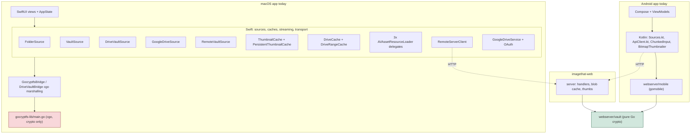
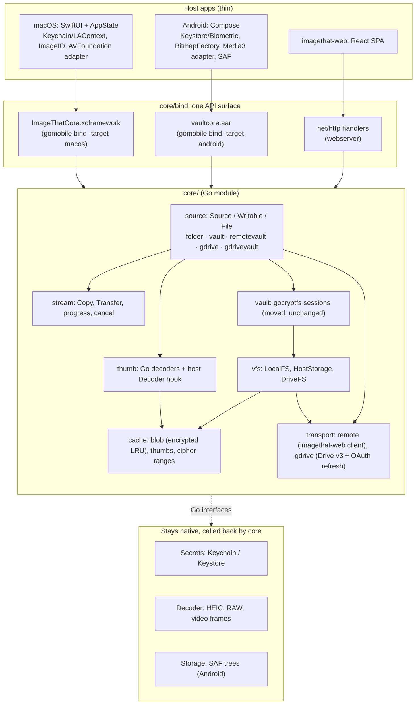
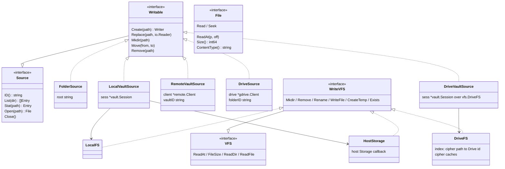
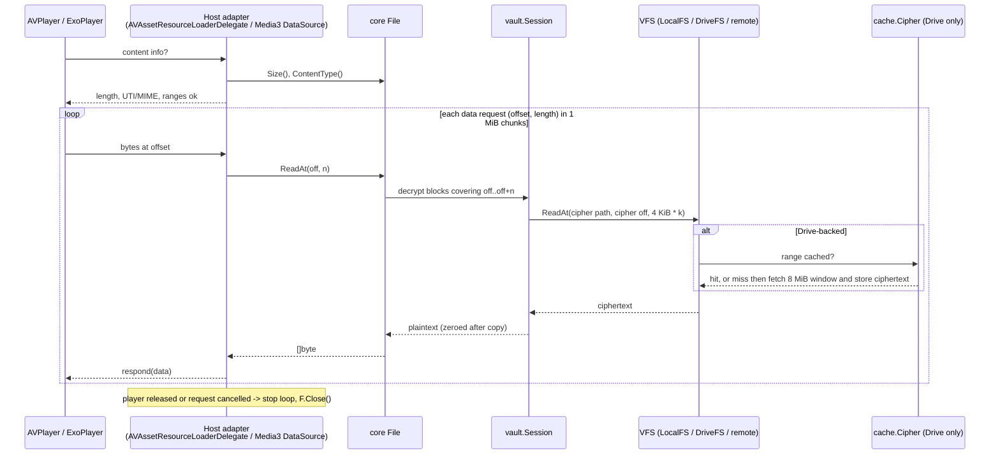
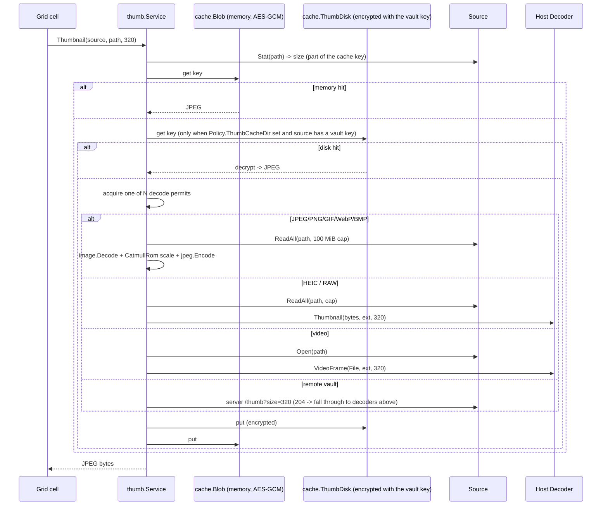
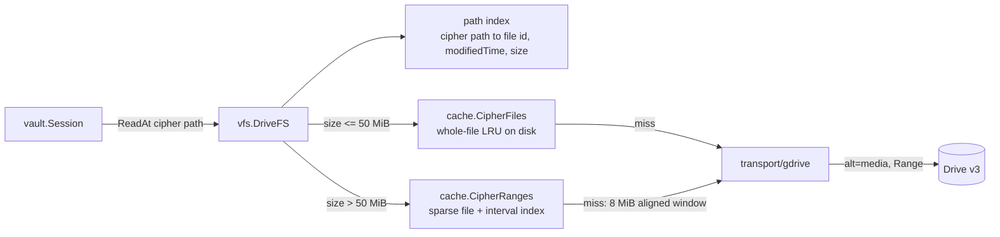
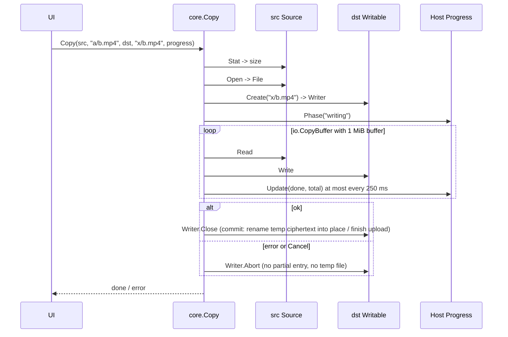
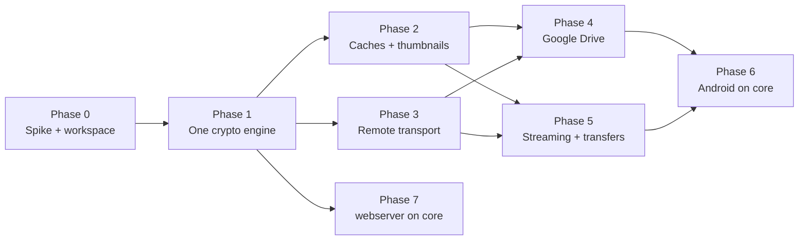

# Go core: moving file handling, caching, streaming and transport out of the Mac app

Date: 2026-10-29
Status: proposed

## Intent

**What the user asked for**

Take the macOS app and move all of the file handling, caching, file-layer
abstractions, streaming and data transport down into Go, so the same code can
be reused by the Android app (and the webserver) instead of being written a
second and third time in Swift and Kotlin.

**What this document is**

A design and a phased plan. It describes what exists today, what the Go core
looks like when the move is finished, how the two apps talk to it, and the
order to get there without breaking the shipping Mac app at any step.

**Rules this plan respects (from `CLAUDE.md`)**

- Nothing working is ripped out and replaced with a different approach. Every
  phase swaps one Swift (or Kotlin) implementation for a Go one *behind the
  same interface*, so the UI code does not change and the old implementation is
  deleted only after the new one passes the same tests.
- Keychain + LAContext stays exactly as it is for Touch ID vault passwords.
  Passwords, master keys and biometrics are platform code and are **not**
  moved. The core receives a password at unlock time and nothing else.
- Decrypted vault content never touches disk. The core enforces this in one
  place instead of five.

## Where things are today

### The Mac app does almost everything in Swift

The Go side of the Mac app (`gocryptfs-lib/main.go`) is a cgo shared library
that only knows how to decrypt and encrypt gocryptfs blocks and names. Every
other concern lives in Swift:

| Concern | Swift today | Lines |
|---|---|---|
| Source abstraction | `MediaSource` / `WritableMediaSource` protocols, 5 implementations | ~1,500 |
| Local folder I/O | `FolderSource` | 229 |
| Local vault I/O | `VaultSource` + `GocryptfsBridge` (cgo marshalling) | 530 |
| Google Drive vault | `DriveVaultSource` + `DriveVaultBridge` + `DriveVaultFS` (VFS callbacks into Go, semaphores) | 840 |
| Google Drive plain folder | `GoogleDriveSource` + `GoogleDriveService` (OAuth, Drive v3 REST) | 900 |
| Remote imagethat-web vault | `RemoteVaultSource` + `RemoteServerClient` | 600 |
| Caching | `ThumbnailCache`, `PersistentThumbnailCache`, `DriveCache`, `DriveRangeCache`, `AppState.imagePreloadCache` | 460 |
| Video streaming | `EncryptedResourceLoader`, `DriveVaultResourceLoader`, `GoogleDriveResourceLoader` (three copies of one loop) | 300 |
| Transfers | `readChunks` / `writeChunks` on every source, progress via `NotificationCenter` | spread |

### The Go crypto exists twice

`webserver/vault` is a second, newer implementation of the same gocryptfs logic,
written as an ordinary Go package because the cgo library has no importable
API. It is already the engine behind the webserver and, through
`webserver/mobile` and gomobile, the Android app. `webserver/README.md`
documents what it fixes over `gocryptfs-lib`:

| Behaviour | `gocryptfs-lib` (Mac) | `webserver/vault` (web + Android) |
|---|---|---|
| Random access | re-reads and re-parses the file header on every range request | parsed once at `Open` |
| Writing a file | whole plaintext buffered in memory | streamed block by block into a temp ciphertext file |
| Path resolution failure | falls back to the plaintext path, surfaces as a bogus "not found" | returns the real error |
| `..` in a path | not checked | rejected |
| XChaCha20 vaults | cannot open (fixed IV length) | opens |
| Logging | appends plaintext vault paths to `/tmp/gocryptfs.log` unconditionally | opt-in `Logf`, off by default |

### The Android app already re-implements the Swift layer in Kotlin

`android/.../data/Sources.kt` is a Kotlin `VaultSource` interface with a
`RemoteSource` (OkHttp) and a `LocalSource` (gomobile `Vault`), its own chunked
reader, its own thumbnailer and its own error mapping. `remote/ApiClient.kt` is
a Kotlin port of `RemoteServerClient.swift`. That is the third copy of the
transport and the second copy of the source layer.

### Defects the current split causes

These are not the reason for the move, but the move fixes them for free and the
plan calls them out so they are tested:

1. **`VaultSource.writeChunks` writes plaintext into the ciphertext directory.**
   It opens `bridge.vaultPath/<plain path>` with `FileHandle` and writes the
   decrypted chunks there (the comment assumes a FUSE mount that does not
   exist). This breaks the no-plaintext-on-disk rule for every drag-and-drop or
   Finder import into a local vault. `vault.Session.Create` streams and
   encrypts; routing imports through it closes the hole.
2. **`gocryptfs-lib` logs plaintext paths to `/tmp/gocryptfs.log`.**
3. **Drive vault writes buffer the entire plaintext, then the entire ciphertext,
   in memory** (`DriveVaultSource.writeChunks` → `encryptData` → upload).
4. **Three resource loaders, three chunk loops, two `readFileInChunks`.** Each
   fix (the `released` flag that stops a loop after the player is gone, for
   example) landed in one copy.
5. **No certificate pinning on the Mac remote client**; Android has it.



Red: the duplicate crypto that goes away. Green: the implementation everything
converges on.

## Target architecture

One Go module, `core/`, owns every concern below the UI that is not a platform
secret, a platform decoder or a platform file picker. Swift and Kotlin become
thin shells: UI, platform adapters that satisfy a few small Go interfaces, and
nothing else.



### Repository layout after the move

```
core/                          Go module github.com/adrianj98/imaginethat/core
  go.mod
  vault/                       moved from webserver/vault, code unchanged
  vfs/                         LocalFS (from vault/vfs.go), HostStorage (from mobile/storage.go), DriveFS (new, port of DriveVaultFS.swift)
  source/                      Source interfaces; folder/, localvault/, remotevault/, gdrive/, gdrivevault/
  stream/                      Copy, Transfer, Progress
  thumb/                       Go image decode (from server/thumb.go) + Decoder host interface + concurrency limit
  cache/                       blob.go (from server/cache.go), thumbs.go, cipher.go (ports of DriveCache + DriveRangeCache)
  transport/remote/            imagethat-web HTTP client (port of RemoteServerClient.swift / ApiClient.kt)
  transport/gdrive/            Drive v3 REST + token refresh (port of GoogleDriveService.swift)
  errs/                        stable error codes shared by every binding
  bind/                        the gomobile-shaped API (flat types, []byte, interfaces); replaces webserver/mobile
  internal/gocryptfs/          generated by scripts/sync-gocryptfs.sh (gitignored), as today
webserver/                     imports core; keeps cmd/, server/ (HTTP + sessions + rate limit), web/
android/                       app/libs/vaultcore.aar now built from core/bind
ImageThat/                     Swift; Services/ shrinks to Keychain, PasswordStore, AppSettings, platform adapters
gocryptfs-lib/                 deleted at the end of Phase 1
go.work                        core + webserver
```

`webserver` keeps `server/` because HTTP sessions, cookies, CSRF and rate
limiting are server concerns, but its vault, cache and thumbnail code moves to
`core` and it imports them back. `webserver/mobile` is replaced by `core/bind`,
which serves both platforms.

## The core API

### Sources and files

Everything the UI browses is a `Source`. A source is one root: a plain folder,
an unlocked local vault, a vault on an imagethat-web server, a Drive folder, or
a vault inside a Drive folder. Paths are source-relative, slash separated, and
validated by `vault.CleanPath` on the way in (already the rule in `vault/`).

```go
package source

type Kind int // KindImage, KindVideo, KindOther

type Entry struct {
    Name  string
    Path  string // source-relative plaintext path
    IsDir bool
    Size  int64  // plaintext bytes; 0 for directories
    Kind  Kind
}

// Source is read access to one root. Safe for concurrent use.
type Source interface {
    ID() string            // stable key: vault path, gdrive://<folder>, imagethat-server://..., used for caches and saved passwords
    DisplayName() string
    List(ctx context.Context, dir string) ([]Entry, error)
    Stat(ctx context.Context, path string) (Entry, error)
    Open(ctx context.Context, path string) (File, error)
    // Close locks the source: wipes keys, drops every cache keyed to ID().
    Close() error
}

// File is an open plaintext view. ReadAt is what players and thumbnailers use;
// Read/Seek is what http.ServeContent and stream.Copy use. Nothing is buffered
// whole and nothing is written anywhere.
type File interface {
    io.ReaderAt
    io.ReadSeekCloser
    Size() int64
    ContentType() string
}

// Writable is a Source that can be changed.
type Writable interface {
    Source
    // Create streams a new file in; the entry appears on Close. Cancelling ctx
    // or calling Abort leaves no partial entry and no temp ciphertext.
    Create(ctx context.Context, path string) (Writer, error)
    // Replace atomically overwrites an existing file (edited images).
    Replace(ctx context.Context, path string, r io.Reader) error
    Mkdir(ctx context.Context, path string) error
    Move(ctx context.Context, from, to string) error
    Remove(ctx context.Context, path string) error
}

type Writer interface {
    io.WriteCloser
    Abort() error
}
```

`vault.File` already satisfies `File` for local vaults (it is an
`io.ReadSeeker` + `io.ReaderAt` + `io.Closer`). The other four sources get the
same shape:



The two vault sources are the same type (`localvault`) over different VFSs;
`DriveVaultSource` is that type over `vfs.DriveFS`. There is one gocryptfs
engine and one path-resolution routine for all three.

### What the host must implement

Three small interfaces, each with one job that genuinely cannot be done in Go:

```go
package bind

// Secrets is Keychain on macOS and the Keystore-wrapped store on Android.
// The core uses it only for OAuth refresh tokens and client credentials. Vault
// passwords never pass through it: the host unlocks a vault by handing the
// password to Open*, exactly as today, and the core wipes it after key
// derivation.
type Secrets interface {
    Get(key string) (string, error)
    Set(key, value string) error
    Delete(key string) error
}

// Decoder renders formats Go cannot: HEIC/HEIF, camera RAW, and video frames.
// Input and output are bytes in memory; the host must not spool to disk.
type Decoder interface {
    // Thumbnail returns JPEG bytes for an image whose encoded bytes are data.
    Thumbnail(data []byte, ext string, maxEdge int) ([]byte, error)
    // VideoFrame returns JPEG bytes for a frame of the video readable via f.
    VideoFrame(f File, ext string, maxEdge int) ([]byte, error)
}

// Storage is the existing Android SAF contract from webserver/mobile, unchanged.
type Storage interface { /* ReadAt, FileSize, ListDir, WriteFile, OpenWriter, Mkdir, Remove, RemoveAll, Rename, Exists */ }

// Progress receives transfer updates.
type Progress interface {
    Update(done, total int64)
    Phase(name string) // "reading", "writing", "uploading"
}
```

Everything else the UI needs is a method on a core object.

### The binding surface (`core/bind`)

gomobile can only pass primitives, `string`, `[]byte`, `error`, and pointers to
exported structs or interfaces. `core/bind` is the flat façade over the
packages above, the same shape `webserver/mobile` has today, extended:

```go
package bind

type Core struct{ ... }
func New(policy *Policy, secrets Secrets, decoder Decoder) (*Core, error)

// Policy is the only place disk is mentioned. Empty dirs mean memory only.
type Policy struct {
    ThumbCacheDir   string // encrypted thumbnails; macOS ~/.imagethat/cache/thumbnails, Android ""
    CipherCacheDir  string // Drive ciphertext; macOS ~/.imagethat/cache/drive, Android noBackupFilesDir or ""
    ThumbMemBytes   int64
    ThumbDiskBytes  int64
    CipherDiskBytes int64
    ChunkBytes      int    // host<->core transfer unit, default 1 MiB
}

// Opening sources. Each returns a *Source handle the host keeps for the session.
func (c *Core) OpenFolder(dir string) (*Source, error)
func (c *Core) OpenVault(dir, password string) (*Source, error)
func (c *Core) OpenStorageVault(s Storage, password string) (*Source, error)
func (c *Core) InitVault(dir, password string) error
func (c *Core) InitStorageVault(s Storage, password string) error
func (c *Core) ConnectServer(baseURL, pinnedSHA256 string) (*Server, error)
func (s *Server) Vaults() (string, error)                    // JSON []RemoteVault
func (s *Server) Unlock(vaultID, password string) (*Source, error)
func (c *Core) ConnectDrive(clientID, clientSecret string) (*Drive, error) // tokens via Secrets
func (d *Drive) OpenFolder(folderID string) (*Source, error)
func (d *Drive) OpenVault(folderID, password string) (*Source, error)
func (d *Drive) FindVaultRoot(folderID string) (string, error)

// Browsing and reading.
func (s *Source) List(dir string) (string, error)            // JSON []Entry
func (s *Source) Stat(path string) (string, error)
func (s *Source) Open(path string) (*File, error)
func (f *File) Size() int64
func (f *File) ReadAt(off int64, n int) ([]byte, error)      // short at EOF, never past it
func (f *File) Close() error
func (s *Source) Thumbnail(path string, maxEdge int) ([]byte, error) // JPEG; cached
func (s *Source) ReadAll(path string, limit int64) ([]byte, error)   // bounded whole-file read for image display

// Writing.
func (s *Source) Create(path string) (*Writer, error)
func (w *Writer) Write(p []byte) error
func (w *Writer) Close() error
func (w *Writer) Abort() error
func (s *Source) Replace(path string, data []byte) error
func (s *Source) Mkdir(path string) error
func (s *Source) Move(from, to string) error
func (s *Source) Remove(path string) error

// Transfers between any two sources, with progress and cancellation.
func (c *Core) Copy(src *Source, srcPath string, dst *Source, dstPath string, p Progress) (*Transfer, error)
func (t *Transfer) Cancel()

// Locking.
func (s *Source) Close() error   // wipes keys + caches for this source
func (c *Core) LockAll()
```

Errors cross the boundary as `*errs.Error{Code, Message}` and, where the
binding can only carry a message, as the stable `code: message` prefix the
Android app already switches on (`wrong_password`, `not_found`, `exists`,
`invalid_path`, `closed`, `read_only`, `unavailable`, plus new `network`,
`cert_mismatch`, `locked`, `cancelled`, `unsupported`).

### Why gomobile for macOS too

Today the Mac uses a hand-written cgo header with C structs and function
pointers, and Android uses gomobile. gomobile supports `-target=macos` (and
`maccatalyst`, `ios`) and produces an `.xcframework` whose Objective-C classes
Swift calls directly, with the same object model Kotlin gets from the `.aar`.
Using it on both platforms means:

- one `core/bind` package, one API, one set of binding tests;
- no manual `malloc`/`free`/`strdup` marshalling in Swift
  (`GocryptfsBridge`, `DriveVaultFS.buildListResult`);
- host callbacks are plain Swift classes conforming to a protocol, instead of
  `@convention(c)` function pointers with an opaque context pointer and
  `DispatchSemaphore` bridges;
- `make core-mac` and `make core-android` are the same command with a different
  target.

Fallback if the Phase 0 spike finds a blocker (gomobile's macOS support is
less travelled than its Android support): keep `-buildmode=c-shared` and
generate the C header from `core/bind` with a small cgo file. The Go code above
the binding is identical either way; only `core/bind` differs.

## How the hard paths work

### Video playback

Both players want byte ranges. The core gives each a `File` with `ReadAt`; the
host adapter is a few dozen lines and does no I/O logic of its own.



What changes: the three Swift resource loaders collapse to one that only knows
`File`. Android's `VaultDataSource` already has this shape and simply points at
the core `File` instead of `LocalVaultApi`. The remote case stops going through
`RemoteRangeReader`'s semaphore trick: `remotevault.File.ReadAt` issues the
`Range` request in Go.

Alternative considered: a loopback HTTP server inside the core
(`http.ServeContent` over `File`, random per-session token, bound to
127.0.0.1) so both players are handed a plain URL and no adapter exists at all.
It reuses `webserver/server/handlers_media.go` verbatim. Rejected for the first
pass because it moves plaintext across a socket (still never disk, but a wider
surface) and because the adapters already exist on both platforms. It stays on
the table if the adapter approach proves awkward for `AVAssetImageGenerator`
on macOS.

### Thumbnails

One service, three tiers, and the host only ever supplies pixels.



- The memory tier is `webserver/server/cache.go`'s encrypted LRU, moved to
  `core/cache`. Its key dies with the source, so `Close()` makes every cached
  preview unreadable at once.
- The disk tier is `PersistentThumbnailCache` ported: entries are sealed with
  the vault's own content encryption (`Session.SealBlob` / `OpenBlob`, the
  existing `GocryptfsEncryptData` logic moved into `vault/`), keyed by
  `sha256(source ID)/sha256(path)`, invalidated by plaintext size. Only sources
  with a vault key can use it; remote vaults (no local key) are memory-only by
  construction, which is what the Mac does today by accident and what Android's
  design requires.
- The old `~/.imagethat/cache/thumbnails` format is not read; it is a cache,
  and the first run of the new version clears it.
- The decode-permit count replaces Android's `Semaphore(2)` and the Mac's
  unbounded concurrency with one policy.

### Google Drive vaults

`DriveVaultFS.swift` becomes `vfs.DriveFS` in Go. The path index (cipher path to
Drive ID), the "list parent before resolving a child" rule, the 50 MiB
whole-file threshold and the 8 MiB aligned prefetch window are kept exactly;
they are the parts that make a 1 GB video playable over the Drive API. What
disappears is the plumbing: C callbacks, `Unmanaged` context pointers, and the
`DispatchSemaphore` bridge from Go goroutines into Swift actors. In Go the VFS
calls the Drive client directly.



Both caches hold ciphertext only, so they may live on disk on either platform.
The `Policy` decides where (or that they do not exist). Writes improve too:
`DriveVaultSource.Create` runs `vault.encryptStream` into a Drive resumable
upload in 8 MiB parts, so a large import is bounded in memory instead of
holding plaintext and ciphertext whole.

### Transfers between sources

`AppState.importFiles`, `handleTransferDrop` and `handleRemoteTransferDrop`
each wire `readChunks` to `writeChunks` and listen for notifications. In the
core this is one function:



`Transfer` is cancellable through `context`; the Mac's `fileTransferTask` and
Android's `job.ensureActive()` both map onto `Transfer.Cancel()`. Same-source
moves stay `Move`.

### Remote vaults

`transport/remote` is the Go port of the two existing clients. It keeps every
behaviour both of them carry:

- in-memory cookie jar, no HTTP cache, `no-store` honoured;
- password kept in memory per vault and one automatic re-unlock on 401 (from
  the Swift client);
- streaming upload with an `io.Pipe` body, preceded by a cheap `list` so an
  expired session is renewed before a body that cannot be replayed (Swift);
- strict query encoding so `a+b.jpg` names the right file (Swift);
- optional leaf-certificate SHA-256 pinning (Kotlin);
- stable error mapping: 401 → `locked` or `wrong_password`, 403 origin →
  `origin_rejected`, 404 → `not_found`, 409 → `exists`, 429 → `rate_limited`.

The Mac gains pinning; Android loses 270 lines of OkHttp.

## What touches disk

The rule is enforced in one place: `core/cache` is the only package that
writes outside a vault's own ciphertext directory, and it writes only sealed
or ciphertext bytes.

| Data | Where it lives | Who decides |
|---|---|---|
| Vault keys | memory, wiped on `Close` / `LockAll` | `vault` |
| Decrypted file bytes | caller-owned buffers, zeroed after copy | `vault.File` |
| Thumbnails, memory | AES-GCM sealed under a per-source random key | `cache.Blob` |
| Thumbnails, disk | sealed with the vault's content key, invalid without the password | `cache.ThumbDisk`, only if `Policy.ThumbCacheDir != ""` |
| Drive ciphertext (whole files, ranges) | plain disk files of ciphertext | `cache.Cipher*`, only if `Policy.CipherCacheDir != ""` |
| Uploads in flight | ciphertext temp file in the vault dir, renamed on commit, removed on abort | `vault.Session.Create` |
| Vault passwords, OAuth tokens | Keychain / Keystore via `Secrets` | host, unchanged |
| Server cookie | memory | `transport/remote` |

A Go test (`core/noplaintext_test.go`) points a `Policy` at a temp dir, opens a
fixture vault, browses, thumbnails, plays, copies and uploads a file with a
known marker, then walks the temp dir and the vault dir asserting the marker
appears nowhere. It is the Go twin of Android's `NoPlaintextOnDiskTest` and
runs in CI for every change to `core`.

## Migration plan

Each phase ends with the Mac app building, its integration tests green, and
one more Swift file deleted. Nothing is removed before its replacement passes
the same tests.



### Phase 0: spike and workspace (small)

- Create `core/` with `go.mod`, move `webserver/vault` into it unchanged
  (`git mv`, import rewrite), add `go.work` so `webserver` resolves `core`
  locally. `webserver/scripts/sync-gocryptfs.sh` becomes
  `core/scripts/sync-gocryptfs.sh`; `gocryptfs-lib`'s copy is no longer needed.
- Prove `gomobile bind -target=macos ./core/bind` produces an xcframework that
  SwiftPM links, and that a Swift class can satisfy a Go interface. Prove an
  `AVURLAsset` plays a fixture video through a Go `File` handle.
- Decide gomobile vs cgo for macOS from the spike result. Record it in this
  document.

Exit: `make core-test`, `make core-mac`, `make core-android` targets exist;
`webserver` builds against `core/vault`.

### Phase 1: one crypto engine for the Mac

- `core/bind` exposes `OpenVault`, `InitVault`, `List`, `Stat`, `Open/ReadAt`,
  `Create/Write/Close/Abort`, `Replace`, `Mkdir`, `Move`, `Remove`,
  `SealBlob/OpenBlob` (for the thumbnail cache until Phase 2), `Close`.
- `GocryptfsBridge.swift` is reimplemented over the binding with its public
  Swift API unchanged (`listDirectory`, `readRange`, `fileSize`, `writeFile`,
  `moveFile`, `mkdir`, `deleteFile`, `deleteDirectory`, `encryptData`,
  `decryptData`). `VaultSource.swift` and `AppState.swift` do not change.
- `VaultSource.writeChunks` is rewritten to feed `Create` (fixes defect 1).
- `Tests/IntegrationTest.swift` and `SlowVideoTest.swift` run unchanged; the
  slow-drive test's `SlowVaultReader` becomes a Swift `Storage` implementation.
- Delete `gocryptfs-lib/`, `CLibGocryptfs/`, `ImageThat/libgocryptfs.h`,
  `Scripts/build-golib.sh`; update `Makefile`, `Package.swift`, `project.yml`.

Exit: Mac app opens AES-GCM, AES-SIV and XChaCha fixture vaults; no
`/tmp/gocryptfs.log`; no-plaintext test passes for local vault imports.

### Phase 2: caches and thumbnails in Go

- Move `webserver/server/cache.go` → `core/cache/blob.go`,
  `webserver/server/thumb.go` → `core/thumb`. Add `cache.ThumbDisk`
  (port of `PersistentThumbnailCache`), `thumb.Service` with the decode-permit
  limit and the `Decoder` hook.
- Swift implements `Decoder` with ImageIO (HEIC/RAW) and
  `AVAssetImageGenerator` over the `File` adapter (video).
- `AppState.loadThumbnail` becomes one call: `source.Thumbnail(path, px)`.
  Delete `ThumbnailCache.swift`, `PersistentThumbnailCache.swift`, the
  `VaultCryptoBridge` protocol, and the per-source `loadThumbnail` methods.
  `imagePreloadCache` (next/previous full image) stays in `AppState`; it is UI
  prefetch, not storage.
- Preferences "clear thumbnail cache" calls `core.ClearThumbCache()`.

Exit: grid performance equal or better on a 5,000-item vault (measure before
and after); thumbnails for HEIC and video still render; cache survives relaunch
and is unreadable without the password.

### Phase 3: remote transport in Go

- `core/transport/remote` and `core/source/remotevault`. Behaviour list in
  "Remote vaults" above is the acceptance checklist; `webserver/server` tests
  gain a client round-trip suite that exercises it against the real server
  in-process (`httptest`).
- `RemoteVaultSource.swift` shrinks to constructing the core source;
  `RemoteServerClient.swift` and `RemoteRangeReader` are deleted. The Mac gains
  the certificate-pinning option in "Add server".

Exit: `Tests/RemoteServerTest.swift` passes against the core client; a
multi-GB upload from the Mac holds under a few MiB of memory in the core.

### Phase 4: Google Drive in Go

- `core/transport/gdrive`: Drive v3 calls, token refresh, multipart and
  streamed resumable upload. The browser leg of OAuth stays in Swift
  (`LocalOAuthServer`, `NSWorkspace.open`); it hands the authorization code and
  redirect URI to the core, which exchanges and stores tokens through
  `Secrets`. Moving tokens from the settings plist into Keychain is a side
  effect worth having.
- `core/vfs/DriveFS` + `core/cache/cipher.go` (ports of `DriveVaultFS`,
  `DriveCache`, `DriveRangeCache`), `core/source/gdrive`,
  `core/source/gdrivevault`.
- Swift: `GoogleDriveSource`, `DriveVaultSource`, `DriveVaultBridge`,
  `DriveVaultFS`, `DriveCache`, `DriveRangeCache`, most of
  `GoogleDriveService` deleted. `GoogleDriveSetupView` cache controls call core.

Exit: Drive vault video seeks with the same round-trip count as today (log the
Drive requests per seek before and after); Drive import of a 2 GB file stays
bounded in memory; existing `~/.imagethat/cache/drive-*` directories are
migrated or cleared on first run.

### Phase 5: streaming and transfers

- `core/stream.Copy` and `Transfer`; `bind.Copy` with `Progress`.
- One Swift resource loader (`CoreFileResourceLoader`) over `File`; delete
  `EncryptedResourceLoader`, `DriveVaultResourceLoader`,
  `GoogleDriveResourceLoader`. `MediaSource.createPlayerItem` becomes a
  protocol extension that wraps `Open`.
- `AppState.importFiles` / `handleTransferDrop` / `handleRemoteTransferDrop`
  call `Copy`; `readChunks` / `writeChunks` and the `NotificationCenter`
  progress channel are deleted. `MediaSource` keeps its Swift shape but every
  implementation is now a thin wrapper over a core `Source`; at this point the
  five Swift sources can become one `CoreMediaSource`.

Exit: a 20-second slow-drive video starts within the same time as today in
`SlowVideoTest`; cancelling an import mid-file leaves no entry anywhere.

### Phase 6: Android on the core

- `android/vaultcore/build.sh` binds `core/bind` instead of
  `webserver/mobile`. Kotlin `LocalSource`, `RemoteSource`, `ApiClient`,
  `ChunkedInput`, `BitmapThumbnailer` and the `SourceError` mapping are
  replaced by the binding; `VaultDataSource` reads from the core `File`;
  `ThumbnailFetcher` calls `Source.Thumbnail`. `SafStorage` stays (it is the
  `Storage` host interface). The Keystore/biometric code is untouched.
- Android gains Google Drive sources for free when the product wants them; the
  Drive OAuth browser leg is the only Kotlin to add.

Exit: `android-test` and the instrumented suite pass; `NoPlaintextOnDiskTest`
passes; APK size change recorded.

### Phase 7: webserver on the core

- `server/` imports `core/vault`, `core/cache`, `core/thumb` and deletes its
  own copies. `server/handlers_media.go` serves `source.File` through
  `http.ServeContent` as today.

Exit: `webserver` tests pass unchanged; one gocryptfs engine in the repo.

### What stays in Swift and Kotlin, and why

| Stays | Reason |
|---|---|
| `KeychainManager`, `PasswordStore`, `AppState.getOrCreateMasterKey`, Android `keys/*` | Touch ID / Keystore are platform APIs; `CLAUDE.md` forbids changing the approach |
| `LocalOAuthServer`, browser hand-off for Drive | Needs the system browser and a loopback listener the OS will allow |
| ImageIO / `AVAssetImageGenerator`, `BitmapFactory` / `MediaMetadataRetriever` | Only the platform has HEIC, RAW and video codecs; they are reached through `Decoder` |
| `AVAssetResourceLoaderDelegate`, Media3 `DataSource` | Player glue; about 60 lines each over `File.ReadAt` |
| `SafStorage` | Android document provider access has no Go equivalent |
| `AppSettings`, favorites, sidebar, navigation stack, image preload | UI state |
| `ShortcutManager`, editing pipeline, views | UI |

## Testing

- **Go, unit**: every `core` package; the existing `vault` and `mobile` tests
  carry over. New: `source` conformance suite run against all five
  implementations (list/stat/open/readAt/create/abort/move/remove with the
  same fixtures), `thumb` tiers, `cache` eviction and sealing, `stream.Copy`
  cancellation, `transport/remote` against `httptest` + the real `server`
  package, `transport/gdrive` against a recorded Drive v3 fake.
- **Go, invariant**: `noplaintext_test.go` as described above.
- **Go, interop**: the existing gocryptfs-binary interop tests stay in `vault`.
- **Binding**: a small Swift XCTest and a Kotlin instrumented test that open
  the committed fixture vault through the binding and read a known file; they
  catch gomobile type or lifetime regressions.
- **Mac**: `Tests/IntegrationTest.swift`, `SlowVideoTest.swift`,
  `RemoteServerTest.swift`, `e2e_test.sh` run at the end of every phase.
- **Performance gates**: thumbnail grid time (Phase 2), Drive requests per seek
  (Phase 4), memory ceiling during a 2 GB import (Phases 1, 4, 5), time to
  first frame on the slow drive (Phase 5). Measure before each phase; the
  phase is not done if a gate regresses.

## Risks and how the plan handles them

| Risk | Mitigation |
|---|---|
| gomobile on macOS has rough edges (signing, SwiftPM linking, `maccatalyst` vs `macos`) | Phase 0 spike before any migration; cgo c-shared fallback keeps the rest of the plan intact |
| Binding call overhead for byte transfer | 1 MiB chunks: a 1 GB video is ~1,000 crossings; today's Swift loops already do 256 KiB |
| Go runtime memory in two apps | Already true on Android; measure on the Mac in Phase 1 |
| Host callbacks from Go threads (Decoder, Storage) | gomobile dispatches on arbitrary threads, as `Storage` does today; callbacks must not block on the main thread; documented in `bind` |
| Regressing a behaviour that only one platform had | The feature lists in "Remote vaults" and "Google Drive vaults" are the acceptance checklists; both platforms' tests run against the core |
| Cache format change | Caches are cleared on first run; nothing user-created is in them |
| Scope | Each phase deletes code and ends green; the order allows stopping after any phase with a consistent repo |

## Decisions needed before Phase 1

1. **gomobile for macOS or cgo c-shared** (resolved by the Phase 0 spike).
2. **Player integration**: `File` adapter per platform (recommended) or an
   in-process loopback HTTP server.
3. **Module layout**: new `core/` module with `go.work` (recommended) versus
   growing the `webserver` module in place.
4. **Android Google Drive**: ship it when Phase 6 lands, or keep it out of the
   Android product for now (the core supports it either way).
5. **Thumbnail disk cache on Android**: the design doc for Android forbids any
   disk cache; keeping `Policy.ThumbCacheDir = ""` there is the default. If
   grid performance over SAF needs it, the sealed-with-vault-key tier is
   available without new code.

## Out of scope

Image editing, the UI of either app, the web SPA, password and key management,
release and signing pipelines, and any change to the gocryptfs on-disk format.
