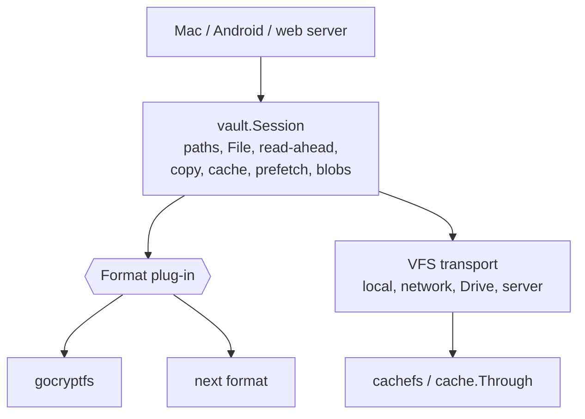

# Pluggable encryption: gocryptfs becomes one vault format

Date: 2026-10-31
Status: design, not started

## Intent

**What the user asked for**

> we should even be able to replace the gocrypto with another plugable encryption

Today a "vault" means a gocryptfs vault, everywhere: in the Go engine, in
the cache layer, in how the Mac, Android and web apps recognise a vault
folder, and in the browser's own decryptor. The goal is that the encryption
scheme is a plug-in behind one interface. gocryptfs is the first plug-in,
and it behaves exactly as it does now. A second scheme can then be added
without touching transports, caching, the viewers or the C API.

**Rules this respects (`CLAUDE.md`)**

- Nothing that works gets replaced. The gocryptfs code moves behind an
  interface without changing. Existing vaults open byte for byte as before,
  and the interop tests against real gocryptfs vaults pass unchanged.
- Keychain + LAContext stays the way the Mac stores vault passwords. A
  password is still saved per vault path, whatever the format.
- Decrypted content never touches disk. A format plug-in gets VFS handles and
  in-memory buffers only.

## Where gocryptfs is wired in today

Most of it is already in one place: `core/vault`.

| Place | What is gocryptfs-specific | Size |
|---|---|---|
| `core/vault/session.go` | `Session` holds `cryptocore`, `contentenc` and `nametransform` directly. `newSession` reads `gocryptfs.conf` flags | About 12 references |
| `core/vault/path.go` | Per-directory `gocryptfs.diriv`, EME names, long-name sidecars | 10 |
| `core/vault/file.go` | 18-byte header, 4 KiB blocks, `CipherSizeToPlainSize` | 8 |
| `core/vault/write.go` | Header and block encryption, `.name` sidecars, diriv on mkdir | 10 |
| `core/vault/blob.go` | `SealBlob`/`OpenBlob` use the gocryptfs file format | 6 |
| `core/vault/init.go` | `configfile.Create`, root diriv | 1 function |
| `core/remote/cached.go` | Cache version tag = the first `contentenc.HeaderLen` bytes | 1 |
| `core/drive/client.go` `FindVaultRoot`, `core/vault` `IsVault` | Detect a vault by looking for `gocryptfs.conf` | 2 |
| Mac `AppState.swift` (3 places), `FolderSource.swift`, `GoogleDriveService.swift` | Same check, in Swift | 5 |
| Android `LocalVaults.kt`, `DriveModels.kt` | Same check, in Kotlin | 2 |
| Web `crypto/vault.ts`, `names.ts`, `content.ts`, `clientVaults.ts` | **A complete second gocryptfs implementation** in TypeScript, for client-decrypt mode | 4 files |
| Shim exports `GocryptfsResolveCipherPath`, `EncryptName`, `LongNameSidecar`; mobile `CipherPath` | Leak ciphertext paths to the apps. The Mac uses one, at `AppState.swift:1182`; Android uses it for Drive cache ranges and refresh | 4 |

The rest is format-neutral already: transports (`LocalFS`, Drive, remote,
`localfs` network mounts), `cache.Through` and `cachefs`, `xfer` copies,
prefetch, thumbnails (through `SealBlob`), the C and gomobile APIs (apart
from their `Gocryptfs` names), and every viewer.

## The key finding: every candidate format fits one content model

The formats worth supporting all store a file the same way: a per-file
header, then fixed-size blocks, each sealed with an AEAD. The nonce is
derived from the block number, and the key from the header.

| Format | Header | Block | Names | Config file |
|---|---|---|---|---|
| gocryptfs | 18 B (version + file ID) | 4 KiB | EME + per-dir IV, long-name sidecars | `gocryptfs.conf` |
| Cryptomator (vault format 8) | 68 B | 32 KiB | AES-SIV, **flattened** tree (`d/XX/…`, dir IDs) | `vault.cryptomator` + `masterkey.cryptomator` |
| rclone crypt | 32 B (magic + nonce) | 64 KiB | EME or obfuscation, same tree | none (key from rclone config) |
| age (STREAM) | variable | 64 KiB | not encrypted | none |

So the random-access machinery (`File.ReadAt`, read-ahead,
`maxBlocksPerRead`, block-aligned prefetch, the range cache, scrubber
fractions) stays in `Session`, parameterised by header length and block
sizes. **The names are where formats really differ.** Cryptomator does not
mirror the plaintext tree at all. So the plug-in must own the whole
namespace: resolving, listing, mkdir, remove and move. It can't just
encrypt one name at a time.

## Design



### Interfaces (in `core/vault`)

```go
// Format is one encryption scheme. Formats register themselves; Open
// asks each in turn whether a VFS holds one of its vaults.
type Format interface {
	Name() string               // "gocryptfs"
	Markers() []string          // files whose presence marks a vault root
	Detect(v VFS) bool
	Init(v WriteVFS, password string, opts InitOptions) error
	Unlock(v VFS, password string) (Keys, error) // ErrWrongPassword, ErrCrypto, …
}

// Keys is an unlocked vault: everything that needs key material.
type Keys interface {
	Names
	Content
	Wipe() // Session.Close calls this
}

// Names owns the ciphertext namespace. Plain paths in, ciphertext paths out.
type Names interface {
	Resolve(plainPath string) (cipherPath string, err error)
	List(plainDir string) (entries []Entry, skipped int, err error)
	PrepareCreate(w WriteVFS, plainPath string) (cipherPath string, commit func() error, err error)
	Mkdir(w WriteVFS, plainPath string) error
	Remove(w WriteVFS, plainPath string) error
	Move(w WriteVFS, from, to string) error
	Forget() // drop name caches (dirIV today) after outside changes
}

// Content is the per-file block cipher.
type Content interface {
	HeaderLen() int
	PlainBS() int
	CipherBS() int
	PlainSize(cipherSize int64) int64
	NewHeader() (header []byte, fk FileKey, err error)
	ParseHeader(header []byte) (FileKey, error)
	DecryptBlock(fk FileKey, blockNo uint64, ciphertext []byte) ([]byte, error)
	EncryptBlock(fk FileKey, blockNo uint64, plaintext []byte) ([]byte, error)
}

type FileKey any // opaque to Session (gocryptfs: the 16-byte file ID)
```

- `vault.Open(v, pw)` and `vault.OpenLocal(dir, pw)` keep their signatures.
  They try each registered format's `Detect`, then call `Unlock`. Callers
  don't change.
- `vault.Init(v, pw)` keeps creating gocryptfs vaults. A new
  `vault.InitFormat(name, v, pw, opts)` picks another format.
- `vault.IsVault(dir)` and a new `vault.Markers()` cover all formats.

### What moves where

- **Into `core/vault/gocryptfs/`** (the plug-in), unchanged in logic:
  - `newSession`'s config handling;
  - `path.go` (diriv cache, EME, long names);
  - the name half of `write.go` (sidecars, diriv on mkdir);
  - `init.go`;
  - header parsing.

  `core/internal/gocryptfs` stays where it is, and the plug-in imports it.
- **Stays in `Session`**:
  - `CleanPath`, `checkOpen`, close and wipe;
  - `File`, which now uses `Content` instead of `contentenc`;
  - `encryptStream`;
  - `SealBlob`/`OpenBlob`, which are built on `Content`, so a thumbnail
    cache is sealed in whichever format the vault uses;
  - `CopyIn`, `CacheFile`, `Prefetch`, `CachedFractions`.

  `Session.Logf` stays, and is passed to the plug-in.
- **Ciphertext-path exports**:
  - `CipherPath` becomes `Session.CipherPath`, which calls
    `Names.Resolve`. It works for every format.
  - `EncryptName` and `LongNameSidecar` become methods of the gocryptfs
    plug-in, reached by a type assertion. Only the shim's tests use them.
    The shim returns "unsupported" for other formats.

### The cache version tag

`remote.RawFS.Stat` hashes the first `contentenc.HeaderLen` bytes. That
becomes "the first `VersionPrefix` bytes". The prefix is the largest header
of any registered format (68 B today). A random per-file ID or nonce sits at
the start of the header in every format above, so this is safe. It also
keeps the cache layer free of format knowledge, since `RawFS` runs before
the vault is unlocked.

### Detecting a vault on clients

Swift, Kotlin and TypeScript stop hard-coding `gocryptfs.conf`. They ask the
engine for the marker list once, through `GocryptfsVaultMarkers()` in the
shim and `Mobile.vaultMarkers()` in gomobile. Then they check for any marker.
For Drive and server listings, `FindVaultRoot` and the server's vault scan
use `vault.Markers()`. The server's vault list reports each vault's
`format`.

### The browser (client-decrypt mode)

The web app has its own gocryptfs decryptor in TypeScript. That way the
server never holds keys, and that has to stay true. There are two ways to
handle another format:

1. **Each format also gets a TypeScript reader.** It's small, read-only and
   proven: it's how gocryptfs works today. But it means two
   implementations of each format.
2. **Compile `core/vault` to WebAssembly.** That gives one implementation
   everywhere. But the bundle grows by about 2–3 MB, WebCrypto is replaced
   by Go's crypto, and it's a larger change to a working system.

**Recommendation:** option 1. Until a format has a TS reader, the web
vault list shows it as "Open in the Mac or Android app". Server-decrypt mode
needs nothing extra, because it uses the Go engine.

### Names that stay

The C API keeps its `Gocryptfs*` symbol names, `GocryptfsBridge.swift`
keeps its name, and so does the `gocryptfs-lib` directory. Renaming them
would churn every client for no behavioural gain. A rename can be a
separate, mechanical change later.

## Plan

Each step lands green on its own: core tests, shim tests, `golib-test`,
`make build`, `test-logic`, the Android unit tests, and the web crypto
tests.

1. **Interfaces, with gocryptfs as the only format.** Add `Format`, `Keys`,
   `Names` and `Content`, then move the gocryptfs code into
   `core/vault/gocryptfs`. `Session` calls through the interfaces. There
   are no API changes. The `interop_test`, `ciphers_test` and fixture
   tests prove the behaviour is identical.
2. **Take format knowledge out of everything else.**
   - `remote` uses `VersionPrefix`.
   - Add `vault.Markers()` and use it in `FindVaultRoot` and the server's
     vault scan.
   - Add `GocryptfsVaultMarkers` and `Mobile.vaultMarkers`.
   - Mac and Android detect vaults with them.
   - Mobile's `CipherPath` goes through `Session.CipherPath`.
3. **Report the format.** Add a `format` field to the server's vault
   list, `Session.Format()`, and the shim and mobile accessors. The UI
   shows it in the vault info. The web app shows "not supported here" for
   formats it can't read.
4. **Second format.** Write the plug-in and its interop tests against
   vaults made by the format's own tool. Then add a TypeScript reader if
   the browser should open it.
5. **Optional: a format picker when creating a vault**, in the Mac and
   Android create flows.

Steps 1–3 are worth doing even if a second format never arrives: they fence
gocryptfs off. Step 1 is the only risky one, and it is a move, not a
rewrite.

## Open questions

- **Which second format?** Cryptomator is the most useful, because it has
  good iOS, Android and desktop apps, so vaults would be shared with those.
  But its flattened namespace is the most work. rclone crypt is the
  simplest. And if the goal is only "not locked into gocryptfs", steps 1–3
  are enough for now.
- **Converting vaults between formats.** With two formats this is a
  `CopyIn` from one session into another, streaming in memory. It's easy
  to add later, and not part of this design.
